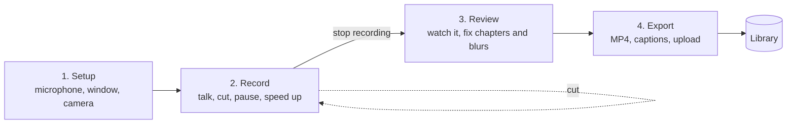
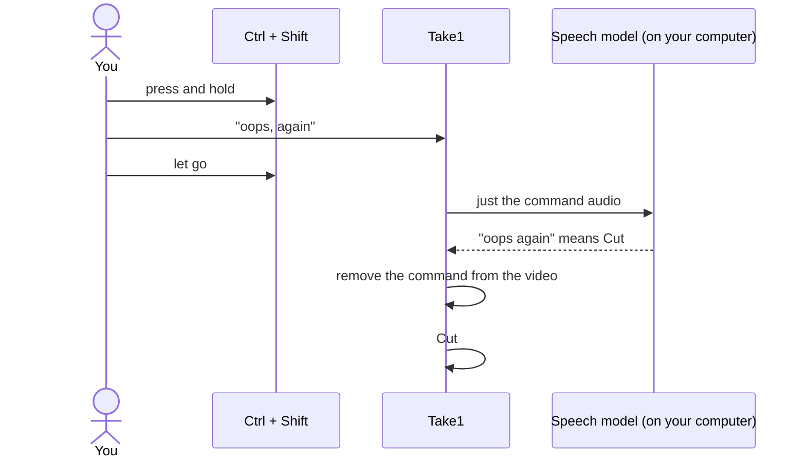
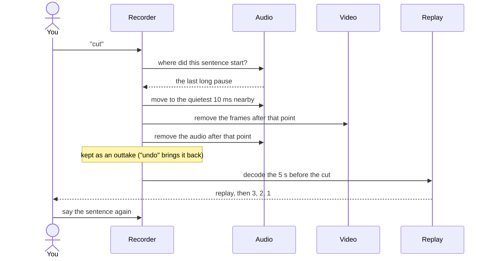
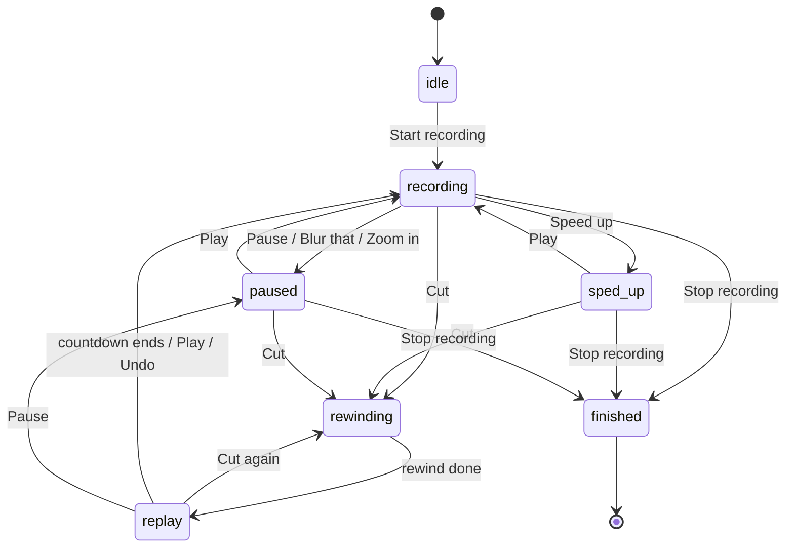
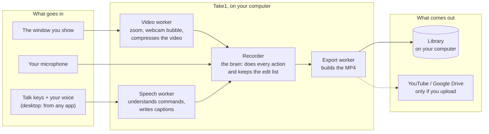
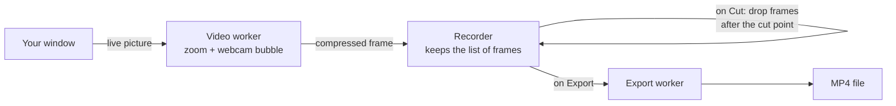

# Take1

**A screen recorder you control with your voice.**

Record your demo the way you would give it live. If you get a sentence wrong, hold <kbd>Ctrl</kbd> + <kbd>Shift</kbd>, say *"cut"* and let go. Take1 removes that sentence, plays back the last few seconds so you can find your rhythm again, counts **3, 2, 1**, and you say it again.

When you stop, the video is already edited. No timeline, no editor, no second pass.

**[▶ Watch the demo](https://youtu.be/eM0dT7hlP1M)** · **[Try it online](https://take1-coral.vercel.app/)** · **[Get the Windows app](https://github.com/ScRocXx/Take1/releases/latest/download/Take1-Setup.exe)**


---

## Contents

- [Why Take1](#why-take1)
- [Get started](#get-started)
- [How it works: the workflow](#how-it-works-the-workflow)
- [Talking to Take1](#talking-to-take1)
- [What you can say](#what-you-can-say)
- [Shortcuts](#shortcuts)
- [The floating bar](#the-floating-bar)
- [What happens when you say "cut"](#what-happens-when-you-say-cut)
- [Review, export and sharing](#review-export-and-sharing)
- [Browser or desktop app?](#browser-or-desktop-app)
- [Your privacy](#your-privacy)
- [Architecture](#architecture)
- [Project structure](#project-structure)
- [Questions and answers](#questions-and-answers)
- [Troubleshooting](#troubleshooting)
- [Known limits](#known-limits)

---

## Why Take1

Most demo videos go wrong in the same way: one sentence comes out badly and you either start again from the beginning or spend an hour cutting out mistakes afterwards.

Audiobook narrators solved this long ago with *punch-and-roll*: stop, hear the last few seconds, and carry on from there. Take1 brings that to screen recording, and you control it with your voice, so your hands stay on the demo.

**Who it's for:** developers recording a hackathon submission or a pull-request walkthrough, DevRel teams, founders making launch videos, teachers and course creators. Anyone who records their screen and talks over it.

---

## Get started

### Option 1: Use it online (nothing to install)

Open **[take1-coral.vercel.app](https://take1-coral.vercel.app/)** in **Chrome or Edge**. Allow the microphone, pick a window, and start recording.

### Option 2: Install the Windows app (recommended)

Download **[Take1-Setup.exe](https://github.com/ScRocXx/Take1/releases/latest/download/Take1-Setup.exe)** (or press *Get the app* on the website) and run it.

Windows may say *"Windows protected your PC"*, because the installer isn't code-signed. Choose **More info → Run anyway**.

The app is better for real recordings: the talk keys work while you're in any other app, and the floating bar and animations never appear in your video.

### Option 3: Run it from the source code

You need **Node.js 18 or newer** and **Chrome or Edge**.

```bash
npm install

npm run dev        # the website version, at http://localhost:5173
npm run app        # the desktop app (talk keys work from any app)
npm run app:dev    # the desktop app, reloading when you change code
npm run dist       # build the Windows installer into release/Take1-Setup.exe (run on Windows)
```

**The first time** you turn on the microphone, Take1 downloads its speech model once (about 60 MB). A larger, more accurate one (about 80 MB) follows in the background. Both are saved, so this only happens once. After that, speech recognition runs **on your computer** and nothing you say is uploaded.

<details>
<summary><b>Publishing the installer on GitHub</b></summary>

The workflow in `.github/workflows/desktop.yml` builds `Take1-Setup.exe` on a Windows machine at GitHub and attaches it to a release. Start it by pushing a version tag:

```bash
git tag v0.3.0
git push origin v0.3.0
```

or by running **Desktop app** from the repository's **Actions** tab. The *Get the app* link points to the latest release, so the repository must be public for other people to download it. To point it somewhere else, set `VITE_DOWNLOAD_URL` when building the website.

</details>

---

## How it works: the workflow

There are four steps. The top bar always shows which one you're on.



### A recording, start to finish

1. **Setup.** Turn on your microphone and choose the window (or whole screen) to record. Adding your webcam is optional. The first time, Setup shows you how push-to-talk works and lets you practise.
2. **Start.** Press **Record**, or hold the talk keys and say *"start recording"*.
3. **Talk through your demo** as if you were showing it to someone live.
4. **Get something wrong?** Hold the keys, say *"cut"*, let go. Take1 removes that sentence, replays the 5 seconds before it, counts 3, 2, 1, and you say it again.
5. **Need a break?** Say *"pause"*, then *"play"* when you're ready. Nothing in between is recorded.
6. **Waiting for something to load?** Say *"speed up"*. The wait plays at 4× in the final video until you say *"play"*.
7. **Something private on screen?** Say *"blur that"* and drag a box over it.
8. **Finish.** Say *"that's a wrap"*. Take1 opens **Review** with the finished video.
9. **Review.** Watch it, get a transcript, add or rename chapters, adjust blurs.
10. **Export.** Download the MP4 with chapters and captions (plain or styled), or upload it to YouTube or Google Drive.


*Zoom spots* (optional): in Setup you can name parts of your window, like "terminal" or "preview". Then *"zoom terminal"* jumps straight there while you record. Or just say *"zoom in"* and draw the area when you need it.

---

## Talking to Take1

### Push to talk

Take1 only listens for commands **while you hold the talk keys** (<kbd>Ctrl</kbd> + <kbd>Shift</kbd> by default) or hold a voice button. Let go and it acts. Everything else you say is simply part of your recording; Take1 never treats it as a command.



- **Your commands don't end up in the video.** The audio from when you started the command until you let go is faded out.
- **Starting a little early is fine.** Take1 keeps the half second before you pressed the keys, so the start of a word isn't lost.
- **Not sure what you said?** A second, more accurate model listens again. If it's still unclear, Take1 shows the closest options to tap.
- **Normal shortcuts still work.** If you press a third key (like <kbd>Ctrl</kbd>+<kbd>Shift</kbd>+<kbd>T</kbd>), Take1 ignores it.
- <kbd>Esc</kbd> cancels while it's listening.

**Other talk keys:** in **Settings** you can choose <kbd>Ctrl</kbd>+<kbd>Win</kbd> (Wispr Flow's Windows default), <kbd>Alt</kbd>+<kbd>Shift</kbd> or <kbd>Right Ctrl</kbd>. *Fn* isn't possible: on Windows laptops the keyboard handles Fn itself and never tells the computer about it.

### Wake phrase: no keys at all (desktop app)

Turn on **Settings → Say "Take one" to give a command**. Then pause for a moment and say:

- **"Take one, cut"** (or "Take one, pause", "Take one, speed up 8x"…), or
- **"Take one"**, wait for the bar to start listening, then say the command.

Only short phrases that start with "Take one" *and* contain a command count, so a sentence like "take one example" in your narration is left alone. The phrase is removed from the video, just like a held-key command. It's off by default because it uses a bit more CPU.

---

## What you can say

You don't need exact words. Take1 matches by meaning and by sound, so everyday phrasing works, and so do common mishearings ("rap" for wrap, "paws" for pause).

| Say | Or | What happens |
| --- | --- | --- |
| **Start recording** | "action", "we're live" | Starts recording |
| **Pause** | "hang on", "one sec", "wait" | Stops recording until you say Play |
| **Play** | "continue", "carry on", "normal speed" | Carries on after Pause or Speed up, or skips the countdown |
| **Cut** | "oops, again", "redo that line" | Removes the sentence you just said, replays 5 s, then records again |
| **Back ten seconds** | "rewind five" | Removes an exact number of seconds |
| **Speed up** | "hold 3x", "fast forward 8x" | The wait plays at 4× (or the speed you say) until Play |
| **Zoom in** | "zoom terminal", "zoom here" | Zooms into a named spot, or pauses so you can draw one |
| **Zoom out** | "full screen" | Back to the whole window |
| **Blur that** | "hide that", "that's private" | Pauses so you can drag over what to blur |
| **Unblur** | "stop blurring" | Ends a blur you left running |
| **Chapter: live demo** | "new chapter setup", "next part" | Adds a chapter with that name |
| **Undo** | "never mind", "cancel" | Undoes the last thing, or cancels a Cut during its replay |
| **Stop recording** | "that's a wrap", "we're done" | Finishes and opens Review |

The big actions (start, pause, play, cut, speed up, undo, chapter, stop) each have a short sound and an animation. Zoom and blur stay quiet, since they usually happen mid-sentence.

| Paused | Sped up | Drawing a blur |
| --- | --- | --- |
|  |  |  |

---

## Shortcuts

Every action also has a button and a keyboard shortcut. In the desktop app the shortcuts work from any app, and you can change them in **Settings**.

| Shortcut | What it does |
| --- | --- |
| Hold <kbd>Ctrl</kbd>+<kbd>Shift</kbd> | Speak a command; let go to send it |
| <kbd>Ctrl</kbd>+<kbd>Alt</kbd>+<kbd>R</kbd> | Start / stop recording |
| <kbd>Ctrl</kbd>+<kbd>Alt</kbd>+<kbd>P</kbd> | Pause / play |
| <kbd>Ctrl</kbd>+<kbd>Alt</kbd>+<kbd>C</kbd> | Cut (no voice needed) |
| <kbd>Ctrl</kbd>+<kbd>Alt</kbd>+<kbd>H</kbd> | Speed up / normal speed |
| <kbd>Ctrl</kbd>+<kbd>Alt</kbd>+<kbd>M</kbd> | Mute / unmute the microphone |
| <kbd>Ctrl</kbd>+<kbd>Alt</kbd>+<kbd>T</kbd> | Show / hide the floating bar |
| <kbd>Esc</kbd> | Cancel a command while listening |

**How it works** in the top bar opens a full guide at any time.


---

## The floating bar

While you're showing another app, you control Take1 from a small bar that floats above everything.

### In the desktop app

A slim bar, **1 cm long**, on the edge of your screen, like Wispr Flow's.

- **Hover** over it and it opens into a column of buttons. Each button's name and shortcut slides out beside it.
- **Hold the talk keys** and it turns into a listening pill with a live waveform, then three dots while it works out what you said.
- **Every command** plays its animation over the whole screen, not just inside Take1.
- **After "cut"**, the replay grows out of the bar in a panel about a quarter of the screen. When the countdown starts, the panel folds back into the bar and **3, 2, 1** counts down across the screen.
- **Its colour shows what's happening:** grey when idle, a faded rose while recording (so it doesn't distract you), amber when paused or replaying, green when sped up.
- **Move it:** press anywhere on it and drag. It follows your pointer onto any screen, and when you let go it glides to the nearest side edge at the height you chose. A press without moving is still a normal click. Take1 remembers where you put it (**Settings → Reset position** puts it back).

**None of this ever appears in your video**, even when you record the whole screen, and it never takes focus away from the app you're showing. Windows does the hiding (Windows 10 version 2004 or newer). Take1 also checks that it really works on your PC: when it starts, a small pink dot blinks beside the bar for a moment while it takes a test screenshot. The result is in **Settings → Hidden from your recordings**. If Windows ever fails to hide them, Take1 tells you and only plays command animations between takes.


### In the browser

Chrome won't let a floating window be see-through or smaller than about 240 × 50 pixels. So in the browser the window itself is the bar: one row with the time, the talk button and the controls. Messages and the countdown briefly replace the buttons.


---

## What happens when you say "cut"

All of this takes about a second, while you're still talking.

1. **Find where the sentence started.** Pauses between sentences are longer than the breaths inside one. Take1 looks back for the most recent long pause (up to 14 seconds back).
2. **Pick a silent spot.** It moves the cut point to the quietest moment nearby, so the join can't be heard.
3. **Remove everything after that point**, both the picture and the sound. The removed part is kept as an *outtake*: say *"undo"* during the replay to bring it back.
4. **Replay the 5 seconds before the cut**, with sound, so you can pick up your tone and pace.
5. **Count 3, 2, 1**, then record again from exactly that point.

While the replay plays, a **screen match** meter checks that your screen looks the way it did where you'll continue, so you don't carry on with the wrong tab open.

If Take1 can't find a sentence at all (for example the microphone was muted), it goes back just 5 seconds and tells you, rather than guessing and removing too much.


<details>
<summary><b>The same thing as a diagram</b></summary>



</details>

<details>
<summary><b>Every state the recorder can be in</b></summary>



</details>

---

## Review, export and sharing

### Review

You see the finished video with every redone sentence already removed. The strip under the player marks the joins (orange), the sped-up parts (green) and the blurs (lavender).

- **Sentences you redid** are listed under the player, so you can hear them again. None of them are in the video.
- **Transcribe** turns your speech into text on your computer. You get a clickable transcript, captions and suggested chapters.
- **Chapters:** add one at the current point, rename or remove them, or let Take1 suggest them from the transcript. It warns you if YouTube wouldn't accept them (YouTube needs at least three, each at least 10 seconds long).
- **Blurs** look exactly as they will in the final video. Use **Adjust** to move or resize one.


### Export


| | |
| --- | --- |
| **MP4** | Your voice is levelled to a comfortable volume, and chapters are built in. If nothing needs drawing in (blurs, styled captions), the recording is copied as it is, so export is fast and loses no quality. |
| **Captions** | Made on your computer. Download them as `.srt` / `.vtt` files, or style them and draw them into the video. |
| **Chapters** | A ready-to-paste list for YouTube (`0:00 Intro`, …). Added to the YouTube description automatically when you upload from Take1. |
| **Send it** | Save to a folder (optionally after every export), upload to YouTube or Google Drive, or use your system's share menu. |

### Caption styles

Below the export cards, **Caption style** shows your video with the captions playing on it, exactly as they'll be drawn into the MP4.

- **8 styles:** Classic, Bold pop, One word, Highlight, Karaoke, Blend, Neon and Marker.
- **Place them** by dragging the caption on the picture, or pick Top, Middle or Bottom.
- **Words at a time:** 1, 2, 3 or a full line.
- **Animation:** pop, rise, fade, bounce, or word by word.
- **The word being spoken** can change colour, get a box or marker stroke behind it, fill in karaoke-style, or grow.
- **Fonts, sizes and colours**, plus UPPERCASE, outline, shadow, glow and background.

The fonts come with the app, so drawing captions in works offline.

### Uploading to YouTube and Google Drive

There are three ways, from least to most setup:

1. **By hand (no setup).** Press *Upload* and choose *Save the file and open YouTube* (or Drive). Take1 saves the MP4, copies the title and description (with chapters) to your clipboard, and opens the upload page. Drag the file in.
2. **Connect your own Google account (once, about 5 minutes).** Then uploads go straight from Take1, with chapters and captions.
   1. In a Google Cloud project, turn on the [YouTube Data API v3](https://console.cloud.google.com/apis/library/youtube.googleapis.com) and the [Google Drive API](https://console.cloud.google.com/apis/library/drive.googleapis.com).
   2. Set up the [consent screen](https://console.cloud.google.com/auth/overview) (External) and add your own Google account as a **test user** under *Audience*.
   3. [Create an OAuth client](https://console.cloud.google.com/auth/clients/create):
      - For the website: type **Web application**, with `http://localhost:5173` (or your site's address) under *Authorised JavaScript origins*.
      - For the desktop app: type **Desktop app**, and copy its client secret too.
   4. In Take1: **Export → Send it somewhere → Connect Google**, and paste the client ID (plus the secret for the desktop app).
3. **Build your client into your own copy.** Put the client ID(s) in a `.env` file (see [`.env.example`](.env.example)). Then everyone using that copy just signs in with Google.

**Good to know:** YouTube keeps videos uploaded through a personal, unreviewed Google project **private**, whatever you choose, until the project passes [YouTube's API audit](https://support.google.com/youtube/contact/yt_api_form). You can change it to public in YouTube Studio afterwards.

### Library

Every export is saved on your computer in the **Library**. You can play, rename, download again (MP4, `.srt`, `.vtt`) or delete recordings. A badge shows when there's one you haven't watched yet. The website and the desktop app keep separate libraries.


---

## Browser or desktop app?

| | Website / `npm run dev` | Desktop app / `npm run app` |
| --- | --- | --- |
| Install | Nothing | `Take1-Setup.exe` (Windows) |
| Talk keys | Only while the Take1 tab or its floating bar is in front | **Anywhere**, even while you type in another app |
| While showing another app | Hold the voice button on the floating bar | Just hold the keys |
| Floating controls | A one-row window (Chrome's Picture-in-Picture) | A 1 cm bar on the screen edge that you can drag anywhere |
| Animations, replay, 3-2-1 | Inside the Take1 tab | Over the whole screen |
| Floating controls in your video? | Yes if you record the whole screen, so record a single window | **No**, they're hidden from screen capture |
| Wake phrase ("Take one, cut") | No | Yes, optional |
| Settings | Record → Settings | Its own Settings page |

Why the difference? Browsers only send key presses to the page you're looking at. That's the usual reason "Ctrl + Shift doesn't work" on the website when another window is in front. The desktop app listens for the keys across the whole system.

---

## Your privacy

- **Your voice stays on your computer.** Speech recognition runs locally. Only the model files are downloaded, once.
- **Your recordings stay on your computer** until you choose to upload them. There is no Take1 server.
- **Google sign-in is optional.** In the desktop app, the sign-in token is stored encrypted by Windows. You can sign out at any time.
- **Take1 only records what you pick.** It never falls back to recording your whole screen on its own.

---

## Architecture

### The big picture

Take1 is a **web app** (React + TypeScript) that also ships as a **Windows desktop app** (Electron). The same code runs in both; the desktop app adds a few powers a website can't have.



The screens (Setup, Record, Review, Export, Library) and the floating bar only *show* what the recorder is doing and *ask* it to do things. In the desktop app, Electron adds the system-wide key listener, the floating bar and full-screen animations (hidden from capture) and the window picker.

### The parts, in plain words

| Part | What it does | Where |
| --- | --- | --- |
| **Recorder** | The brain. Buttons, shortcuts, the floating bar and your voice all ask the recorder to do things (`recorder.run(command)`). It keeps the recorded video and sound, and a list of edits (sped-up parts, blurs, zooms, chapters, muted commands). | `src/engine/recorder.ts` |
| **Store** | A small shared memory of "what's happening now". Each screen only redraws when something it shows changes. | `src/lib/store.ts` |
| **Audio engine** | Records the microphone sound and finds the pauses between sentences (used by Cut). | `src/engine/audio.ts` |
| **Video worker** | Takes the window and webcam pictures, zooms and combines them, and compresses them into video, away from the page so the app stays responsive. | `src/engine/compositor.worker.ts` |
| **Speech worker** | Runs the Whisper speech models on your computer: a small fast one for commands, a larger one for captions and second opinions. A meaning model (MiniLM) matches paraphrases. | `src/voice/` |
| **Export worker** | Builds the MP4: draws blurs and captions if needed, levels the voice volume, adds chapters. | `src/engine/export.worker.ts`, `mp4.ts` |
| **Clock** | A steady 30-frames-a-second tick, which keeps going even when the window is in the background. | `src/engine/ticker.ts` |
| **Desktop shell** | Electron: listens for the talk keys system-wide, shows the floating bar and the full-screen animations (hidden from capture), lets you pick a window, and handles Google sign-in. | `electron/main.cjs` |

### How a frame travels



The video is stored already compressed, as a list of frames. Take1 makes sure the first frame after every cut, pause or speed change is a full picture (a *keyframe*). That's why a cut is instant and the export usually doesn't need to compress the video a second time.

### What makes it work (for developers)

<details>
<summary><b>Editing compressed video without re-encoding</b></summary>

The recording is a list of encoded chunks. A keyframe is forced after every cut, pause and speed change, and once a second otherwise. A cut removes the chunks after the cut point, and the next chunk is guaranteed to be a keyframe, so the result can be copied straight into the MP4.

</details>

<details>
<summary><b>Speed up without an editor</b></summary>

While sped up, frames are still captured, but the output clock moves at 1/N speed, so N seconds of waiting become one. The silence before "speed up" is trimmed and a keyframe is forced at the join.

</details>

<details>
<summary><b>Smooth 30 fps, even when the page is busy</b></summary>

The clock ticks three times per frame, and each frame belongs to a fixed 1/30 s slot. A tick that arrives late (Windows rounds timers to about 16 ms, and the page may be busy) still lands its frame in the right slot, and every frame is stamped on the slot, so playback is even.

</details>

<details>
<summary><b>Recognising short commands reliably</b></summary>

One-word commands are easy to clip. The command audio includes the 0.55 s before the keys went down and 0.2 s after they come up, is trimmed to the speech, raised to a good level and padded before Whisper hears it. Parsing works on words: numbers ("3x", "twenty five") become values, and each word is matched exactly or by how it sounds (Metaphone, `src/voice/phonetic.ts`), so mishearings nobody listed still match. Sentence embeddings (MiniLM) catch paraphrases. If the fast model's answer isn't a command, the larger model listens again before you're asked.

</details>

<details>
<summary><b>Keeping the floating bar out of the video</b></summary>

The bar and the full-screen overlay are transparent, always-on-top windows that never take focus. They're marked with `setContentProtection` (Windows' `WDA_EXCLUDEFROMCAPTURE`), which tells Windows to leave them out of every screen capture. That's re-applied after any window change and every 2 s while recording. To be sure, Take1 flashes a 12 px dot in each window, takes a screenshot through the same capture path the recording uses, and looks for the dot. If it's found, Take1 tries two repairs, and if those fail it reports it and only plays animations between takes.

</details>

<details>
<summary><b>An MP4 writer that streams</b></summary>

`src/engine/mp4.ts` writes the index first, so the file starts playing before it has fully downloaded. Audio and video are interleaved in about 0.5 s runs. It supports H.264 or VP9 video, AAC or Opus audio, chapters (a Nero `chpl` box), and files over 4 GB.

</details>

<details>
<summary><b>Exports can't hang</b></summary>

Exports report progress from their worker. If nothing moves for 30 s, the export stops with a message instead of a frozen progress ring.

</details>

### Built with

React 18 · TypeScript · Vite · Electron · WebCodecs (`VideoEncoder` / `VideoDecoder`) · AudioWorklet · OffscreenCanvas · Web Workers · Transformers.js (Whisper tiny.en / base.en, MiniLM) · uiohook-napi · IndexedDB · Google Identity Services, YouTube Data API, Google Drive API · electron-builder.

---

## Project structure

```
take1/
├─ .github/workflows/
│  └─ desktop.yml           builds Take1-Setup.exe on GitHub and attaches it to a release
├─ build/                   app icon for the installer
├─ electron/
│  ├─ main.cjs              desktop shell: talk keys, shortcuts, floating bar, full-screen overlay, window picker, Google sign-in
│  └─ preload.cjs           the small bridge between the page and the desktop shell
├─ src/
│  ├─ App.tsx               top bar with the four steps, Help, Library, Settings
│  ├─ screens/
│  │  ├─ Setup.tsx          welcome page with practice, then microphone, window, camera, zoom spots
│  │  ├─ Record.tsx         live picture, controls, command list
│  │  ├─ Settings.tsx       all settings (its own page in the desktop app)
│  │  ├─ Review.tsx         player, timeline, redone sentences, transcript, chapters, blurs
│  │  ├─ Export.tsx         MP4, captions, chapters, save / YouTube / Drive / share
│  │  ├─ CaptionDesigner.tsx  caption styles with a live preview
│  │  └─ Library.tsx        every exported recording
│  ├─ engine/
│  │  ├─ recorder.ts        the brain: record, cut, pause, speed up, blur, zoom, finish, export
│  │  ├─ audio.ts           microphone capture, sentence finder, quiet join points
│  │  ├─ compositor*.ts     video worker: combine, zoom, encode, thumbnails, screen match
│  │  ├─ video.ts           the list of recorded frames, keyframe rules
│  │  ├─ replay.ts          decodes the seconds before a cut
│  │  ├─ export*.ts         export worker: blurs, captions, loudness, audio, MP4
│  │  ├─ mp4.ts             MP4 writer with chapters
│  │  ├─ snapshots.ts       thumbnails for the timeline and outtakes
│  │  └─ ticker.ts          the background clock
│  ├─ voice/
│  │  ├─ stt.worker.ts      Whisper + MiniLM, phrase splitting for transcripts
│  │  ├─ stt.ts             talks to the speech worker, prepares command audio
│  │  ├─ intent.ts          the list of commands and how phrases map to them
│  │  └─ phonetic.ts        sound-alike matching
│  ├─ lib/                  store, Library storage, transcript/captions/chapters, sharing, desktop bridge
│  └─ ui/                   floating bar, full-screen overlay, Help, shared components, sounds, styles
└─ docs/images/             the pictures in this README
```

---

## Questions and answers

**Does Take1 send my voice or videos anywhere?**
No. Speech is recognised on your computer and recordings are saved on your computer. Nothing leaves it unless you upload to YouTube or Drive yourself.

**Do I need an account?**
No. A Google account is only needed if you want Take1 to upload for you.

**Does it work offline?**
Yes, after the first run. The speech models download once and are saved. Uploading, of course, needs the internet.

**Which browsers work?**
Chrome and Edge on a computer. Firefox and Safari don't yet support all the video features Take1 uses.

**Is there a Mac or Linux app?**
Not yet. The installer is for Windows; on a Mac or Linux, use the website.

**Will my commands be heard in the video?**
No. The audio from when you start a command until you let go of the keys is removed. The wake phrase is removed the same way.

**What if Take1 removes the wrong part when I say "cut"?**
Say *"undo"* during the replay and the removed part comes back. Or say *"back ten seconds"* to remove an exact amount.

**What if it mishears me?**
A second, more accurate model listens again. If it's still unsure, it shows the closest commands to tap, and nothing happens until you choose.

**Can I talk normally while recording without triggering commands?**
Yes. With push-to-talk, Take1 only listens while you hold the keys. With the wake phrase, only short phrases that start with "Take one" and contain a command count.

**Will the floating bar show up in my video?**
Not in the desktop app: Windows hides it from screen capture, and Take1 checks that this works (**Settings → Hidden from your recordings**). In the browser it can, if you record the whole screen, so record a single window instead.

**Why does the website show a big floating window instead of a tiny bar?**
Chrome doesn't allow a floating window that's see-through or smaller than about 240 × 50 pixels. The desktop app doesn't have that limit.

**Can I record my webcam too?**
Yes. Turn it on in Setup and it appears as a bubble in the corner of the video.

**How long can a recording be?**
There's no fixed limit. Very long recordings use more memory; the MP4 writer handles files over 4 GB.

**Can I change the replay length or the countdown?**
Yes, in Settings: replay from 2 to 8 seconds, countdown from 1 to 5 seconds, and whether the replay plays its sound.

**Can I edit a recording later?**
You can review and change chapters and blurs until you start the next recording. After that, the exported MP4 stays in your Library, but it can't be re-edited in Take1 yet.

**Why does Windows warn me when I install it?**
The installer isn't code-signed (that needs a paid certificate). Choose **More info → Run anyway**.

**How was Take1 built?**
For the Wispr Flow #NoHandsChallenge. The ideas, specs, bug reports and design feedback were all spoken through Wispr Flow, not typed. The demo video was recorded with Take1 itself.

---

## Troubleshooting

**Windows says it protected your PC.** The installer isn't code-signed. Choose **More info → Run anyway**.

**Ctrl + Shift does nothing.** On the website, keys only reach Take1 while its tab (or its floating bar) is in front. Use the voice button on the floating bar, or get the desktop app. If Ctrl + Shift switches your keyboard language, choose another talk key in **Settings**. On the first-use Setup screen, the keys light up as you press them, which shows whether they're getting through.

**The floating bar or the animations show up in my video.** Open **Settings → Hidden from your recordings** and press **Check again** (not while recording). Hiding needs Windows 10 version 2004 or newer. On older Windows, update, or record a single window instead of the whole screen.

**It took a few tries to hear me.** Start speaking as you press the keys, not after. Starting slightly early is fine. If it's still unsure, it shows the closest options to tap.

**"Didn't hear a sentence, so I went back 5 s."** The microphone picked up nothing clear. Say *"cut"* again to go back further, or *"undo"*.

**Transcription says there's no audible audio.** The recording itself is silent. Check that Setup shows the right microphone and that its level bars move when you talk.

**"Speech model couldn't load."** The first time, the model downloads from huggingface.co. Check your connection and press **Try again**. It's saved after that.

**Upload asks how to upload.** Google isn't connected yet. Upload by hand, or connect it once ([how](#uploading-to-youtube-and-google-drive)).

**The page shows old screens after updating.** Stop the dev server and run `npm run dev` again. For the desktop app, close it fully and run `npm run app` again.

---

## Known limits

- **Chrome or Edge only** on the website. Firefox and Safari don't support all of WebCodecs and transferable streams yet.
- **Windows only** for the installer.
- **English only.** Commands and captions use the English Whisper models.
- **A recording is editable until you start the next one.** The Library keeps the exported MP4, but old recordings can't be re-edited yet.
- **Fn can't be the talk key** on Windows.

---

Take1 was built for the Wispr Flow #NoHandsChallenge. Every idea, spec, bug report and design note was spoken, not typed.
