# Take1 🎬

**Mess up out loud. Ship take one.**

Take1 is a screen recorder you direct with your voice. You fluff a line, hold <kbd>Ctrl</kbd> + <kbd>Shift</kbd>, say *“cut”* and let go. Take1 rewinds to the start of that sentence, plays back the last five seconds so you catch your rhythm, counts you in, and you say it again. The bad take never makes it into the video.

When you say *“that’s a wrap”*, the video is already finished: an MP4, captions, chapters, a ready-to-paste post and a blooper reel. You spend no time in an editor.

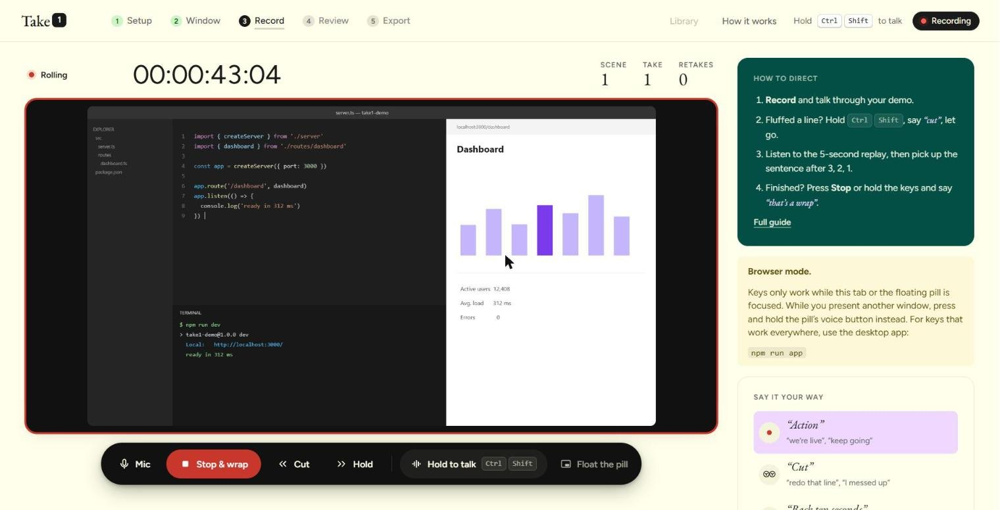

> Built for the **Wispr Flow #NoHandsChallenge**, and built by voice with Wispr Flow.

---

## Contents

- [Why this exists](#why-this-exists)
- [Quick start](#quick-start)
- [A take, start to finish](#a-take-start-to-finish)
- [Push to talk](#push-to-talk-it-never-listens-on-its-own)
- [What you can say](#what-you-can-say)
- [Shortcuts](#shortcuts)
- [The floating pill](#the-floating-pill)
- [How a Cut actually works](#how-a-cut-actually-works)
- [Review, Export and Library](#review-export-and-library)
- [Captions](#captions)
- [Architecture](#architecture)
- [The hard parts](#the-hard-parts)
- [Project structure](#project-structure)
- [Troubleshooting](#troubleshooting)
- [Known limits](#known-limits)

---

## Why this exists

Recording a product demo usually goes like this. You record, stumble on the third sentence, then stop, delete and start over. Or you push through and spend twenty minutes in an editor finding the stumble, cutting it out, and fixing the jump in the picture.

Audiobook narrators solved this decades ago with **punch-and-roll** recording. When they misread a line, the engineer rolls back a few seconds and plays it to them, then punches in at the right moment. The narrator picks up mid-flow, and the fluff is gone for good.

Take1 brings punch-and-roll to screen recording and puts it under voice control, so you can do it without taking your hands off the demo:

| You do | Take1 does |
| --- | --- |
| Fluff a line and say *“cut”* | Finds where your sentence started, rewinds there, deletes everything after it, replays the last 5 s and counts you back in |
| Wait for a build and say *“hold”* | Plays the dead air at 8× until you say *“action”* |
| Say *“zoom terminal”* | Eases the camera into a part of the window you named earlier |
| Flash an API key and say *“redact that”* | Blurs the last 5 s on export |
| Say *“mark it, live demo”* | Drops a named chapter |
| Say *“that’s a wrap”* | Finishes the video |

---

## Quick start

You need **Node 18+** and **Chrome or Edge** (Take1 uses WebCodecs).

```bash
npm install

npm run app        # desktop app, recommended: talk key works from any app
npm run app:dev    # desktop app with hot reload
npm run dev        # browser only, opens http://localhost:5173
```

The first time you turn on the mic, the voice engine downloads once (about 60 MB) and is cached. After that, voice recognition runs **on your computer**. Nothing you say is uploaded.

> **Upgrading from an earlier build?** Run `npm install` again, because new dependencies were added (`electron`, `uiohook-napi`, …). If the dev server shows old screens after you pull changes, stop it and run `npm run dev` again.

---

## A take, start to finish

The top bar shows five steps. You can always see where you are, and later steps unlock as you go.

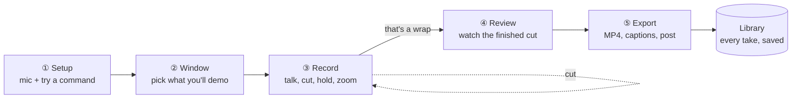

### ① Setup: *mess up out loud*

Turn on the mic, pick an input and watch the level meter. Then **try push-to-talk**: hold the keys (they light up as you press them), say a command and let go. Each command you try turns green. Nothing is recorded in this step, so it's safe to experiment.

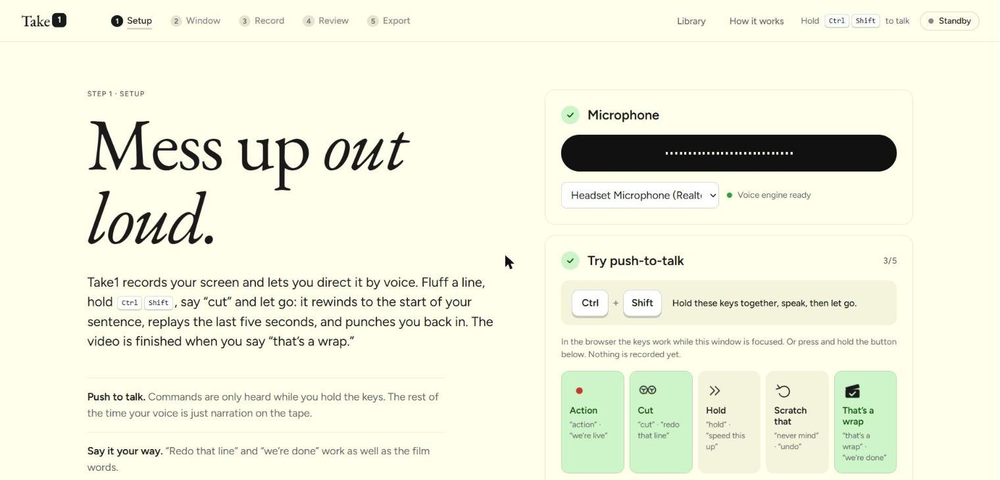

### ② Window: *pick your shot*

Choose the **window** you'll demo. A single window is safer than a whole screen because notifications and other apps stay out of the video. Optionally:

- **Zoom spots.** Drag a box around a part of the window and name it (“terminal”, “preview”). During the take, say *“zoom terminal”* and the camera eases in.
- **Camera bubble.** Puts your webcam in the bottom-right corner.

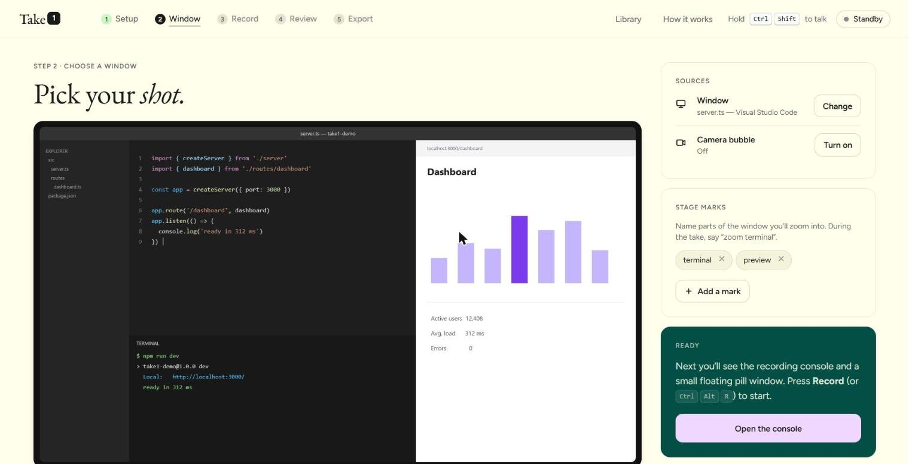

### ③ Record: *direct it*

Press **Record** (or hold the keys and say *“action”*). Talk through your demo like normal. The **How to direct** card on the right is the cheat sheet; **Full guide** opens the manual.

When you say *cut*, the monitor turns into the **replay**. On the left, the last five seconds before the splice play back with sound. On the right are the countdown, a thumbnail of the exact frame you'll resume from, and a **match meter** that turns green when your screen looks the way it did, so you don't punch in with the wrong tab open.

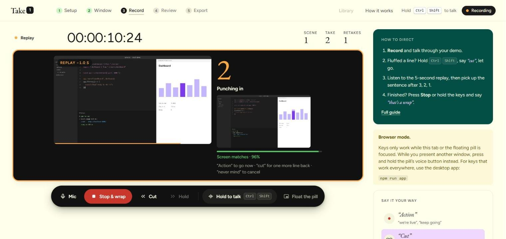

Say *“hold”* while you wait for something slow. The dead air plays at 8× in the final video, and *“action”* brings it back to normal speed.

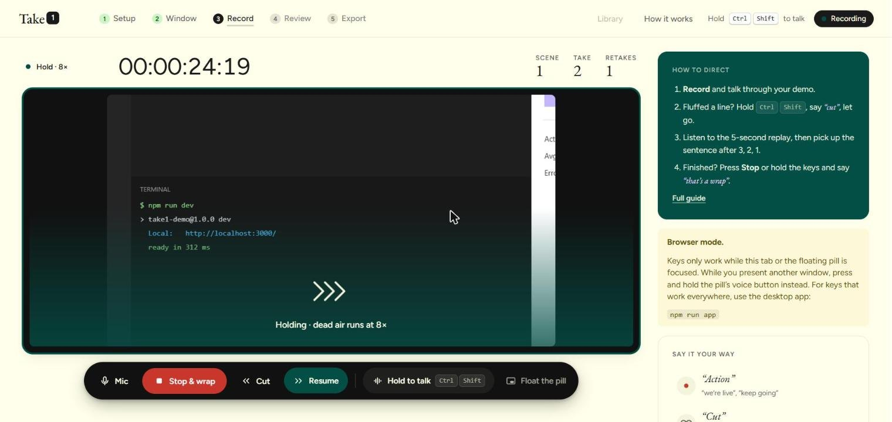

### ④ Review: *here's your take*

This is the finished video, with every retake already spliced in. Watch it and check the strip under the player. Your fluffed lines are kept as **outtakes** further down.

### ⑤ Export: *that's a wrap*

Download the MP4, generate captions, copy the post. See [Review, Export and Library](#review-export-and-library) for the details.

---

## Push to talk: it never listens on its own

Take1 hears commands **only while you hold the talk keys** (default <kbd>Ctrl</kbd> + <kbd>Shift</kbd>), or while you press and hold a **Hold to talk** button. Let go and Take1 acts. The rest of the time, everything you say is narration on the tape and is never interpreted.

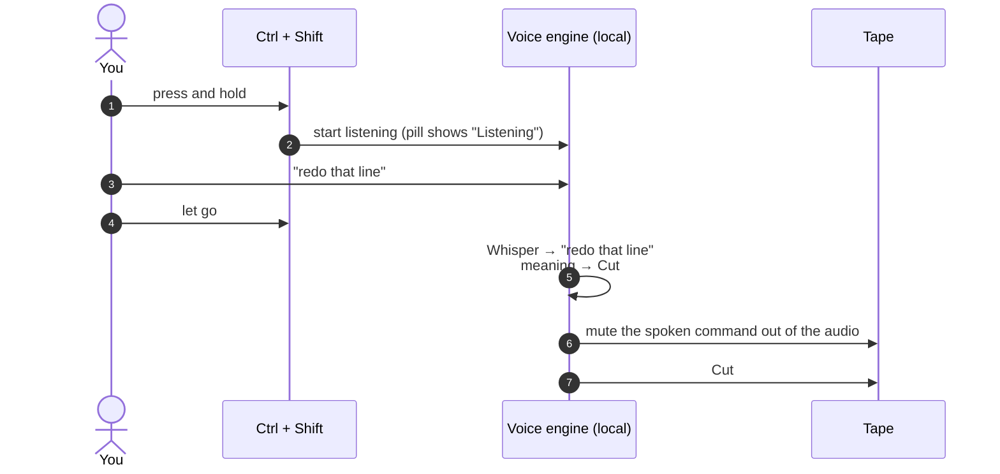

What happens around the keys:

- **Your commands don't end up in the video.** The audio from the moment you pressed the keys until you let go is faded out of the final cut.
- **Real shortcuts still work.** If a third key joins the combo (say <kbd>Ctrl</kbd>+<kbd>Shift</kbd>+<kbd>T</kbd> to reopen a tab), the command is cancelled and nothing happens.
- **Esc** cancels while listening.

### Browser vs desktop app

| | `npm run dev` (browser) | `npm run app` (desktop) |
| --- | --- | --- |
| Talk keys | Only while the Take1 tab or the pill window is **focused** | **Anywhere**, even while you're typing in VS Code |
| While you present another app | Press and hold the pill's voice button | Just hold the keys |
| Pill visible in the recording? | Yes if you capture the whole screen, so pick a window | **Never**: it's excluded from capture |

Browsers only deliver key presses to the page that has focus, and that's the most common reason for “Ctrl + Shift doesn't work”. For a real demo, use the desktop app.

### Why not Fn?

On Windows laptops the <kbd>Fn</kbd> key is handled inside the keyboard itself and never reaches the operating system, so no app can see it (Wispr Flow can't either, which is why its Windows default is <kbd>Ctrl</kbd>+<kbd>Win</kbd>). In **Record → Settings → Talk key** you can pick:

| Talk key | Good for |
| --- | --- |
| <kbd>Ctrl</kbd> + <kbd>Shift</kbd> | Default |
| <kbd>Ctrl</kbd> + <kbd>Win</kbd> | Same as Wispr Flow on Windows |
| <kbd>Alt</kbd> + <kbd>Shift</kbd> | If Ctrl + Shift switches your keyboard language |
| <kbd>Right Ctrl</kbd> | One key, rarely used for anything else |

---

## What you can say

You don't have to memorise exact words. Take1 matches **meaning** with a small embedding model, and it also knows the usual mishearings: *“rap”* means wrap, *“cot”* means cut, *“hole”* means hold.

| Say | Or | What happens |
| --- | --- | --- |
| **Action** | “we're live”, “keep going” | Start rolling, or resume from Hold |
| **Cut** | “redo that line”, “I messed up” | Rewind to the start of your sentence, replay 5 s, punch in |
| **Back ten seconds** | “rewind five” | Rewind an exact number of seconds |
| **Hold** | “speed this up”, “waiting for the build” | Dead air at 8× until *Action* |
| **Zoom terminal** | “focus on the preview” | Ease into a named zoom spot |
| **Wide** | “zoom out”, “full screen” | Back to the whole window |
| **Redact that** | “blur that”, “that was a secret” | Blur the last 5 s on export |
| **Mark it, live demo** | “new chapter: setup” | Drop a named chapter |
| **Scratch that** | “never mind”, “undo” | Undo the last thing, or cancel a Cut while it replays |
| **That's a wrap** | “we're done”, “stop recording” | Finish and open Review |

If Take1 isn't sure what you meant, it doesn't guess. The pill asks *“Did you mean…”* and offers the closest options as buttons.

---

## Shortcuts

Every action also has a button in the dock and the pill, plus a keyboard shortcut. In the desktop app these work from any app, and you can change them in **Record → Settings**.

| Shortcut | Does |
| --- | --- |
| Hold <kbd>Ctrl</kbd>+<kbd>Shift</kbd> | Give a voice command, release to send |
| <kbd>Ctrl</kbd>+<kbd>Alt</kbd>+<kbd>R</kbd> | Start recording / stop and wrap |
| <kbd>Ctrl</kbd>+<kbd>Alt</kbd>+<kbd>C</kbd> | Cut (no voice needed) |
| <kbd>Ctrl</kbd>+<kbd>Alt</kbd>+<kbd>H</kbd> | Hold / resume |
| <kbd>Ctrl</kbd>+<kbd>Alt</kbd>+<kbd>M</kbd> | Mute / unmute the mic |
| <kbd>Ctrl</kbd>+<kbd>Alt</kbd>+<kbd>T</kbd> | Show / hide the floating pill |
| <kbd>Esc</kbd> | Cancel a command while listening |

**How it works** in the top bar opens the full manual at any time.

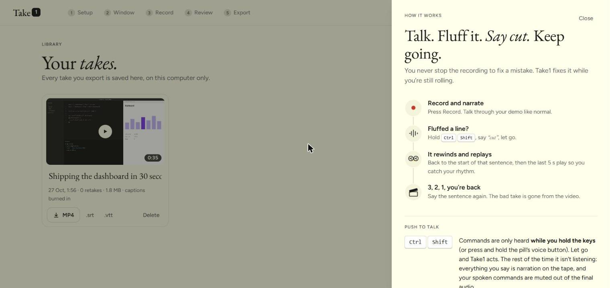

---

## The floating pill

The pill is modelled on Wispr Flow's. It's a small capsule at the bottom of your screen, so you can direct the take without switching back to Take1. In the desktop app it's always on top, never takes focus away from the app you're demoing, and is hidden from the recording.

It's quiet when nothing is happening. When you hover it, it opens into the full controls, and it reacts to every command with its own small animation:

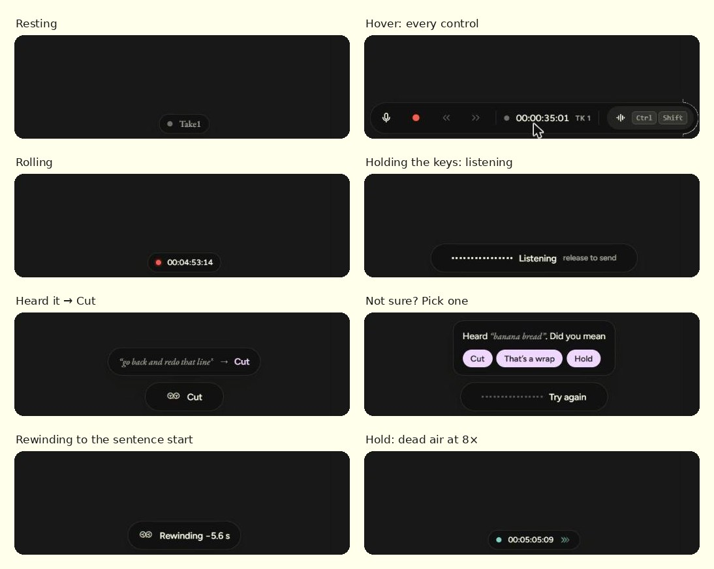

| Action | Animation |
| --- | --- |
| Action | The red tally dot lights with a ripple |
| Cut | Two tape reels spin backwards while the timecode rolls back |
| Hold | Chevrons stream forward in teal |
| Zoom / Wide | Four corners close in on the centre (or open out) |
| Redact | A bar slides over the lines |
| Chapter | A bookmark ribbon drops onto the line |
| Scratch that | An undo arrow sweeps round |
| Wrap / punch-in | The clapperboard snaps shut |

---

## How a Cut actually works

This is the core of Take1, and it all happens in about a second while you're still talking.

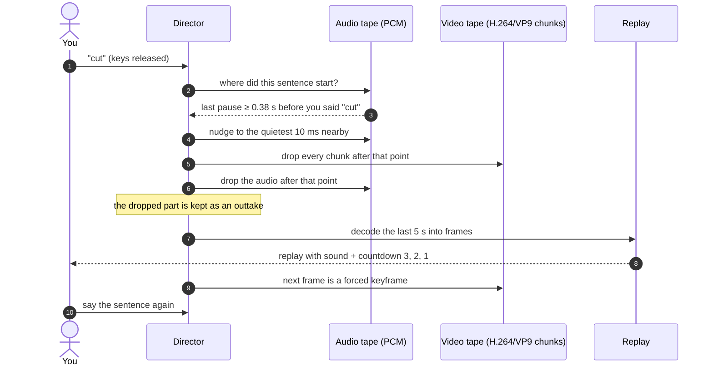

The details that make the splice clean:

- **Finding the sentence.** Take1 keeps a running loudness envelope of the mic. It walks back from the moment you started the command, skips the pause right before “cut”, and stops at the last silence of at least 0.38 s. That silence is where your sentence began. If it can't find one (muted mic, noisy room), it **steps back 5 s** instead of guessing big, and tells you so.
- **Quietest point.** The cut is nudged to the quietest 10 ms within 150 ms, so the join can't be heard.
- **Keyframe at punch-in.** The first frame after the cut is forced to be a keyframe, so the video can be joined without re-encoding.
- **Nothing is thrown away.** The removed piece (video chunks, audio, thumbnails, chapters, zooms) becomes an outtake. Say *“scratch that”* during the replay and all of it is restored.
- **Cut again during the replay.** Each extra *cut* goes back one more sentence.

### The recorder's states

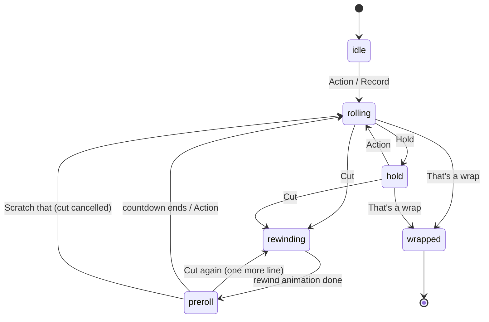

---

## Review, Export and Library

### Review: *“here's your take”*

> Earlier builds called this screen **Dailies**, the film-set word for watching the day's footage. It's now just **Review**.

This is the finished video, with retakes already spliced in. Under the player is a strip of thumbnails with markers:

| Marker | Meaning |
| --- | --- |
| 🟧 orange tick | **Splice**: where a retake was joined |
| 🟩 green band | **Hold**: dead air played at 8× |
| 🟪 lavender stripe | **Redaction**: will be blurred on export (you can adjust the box) |
| ⬜ white tick | **Chapter** |

The stats panel shows what Take1 saved you: retakes done live, seconds of waiting squeezed out, and minutes in an editor (zero).

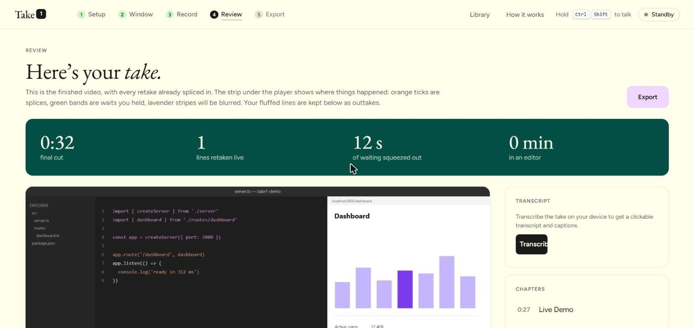

Below the player, every line you retook is an **outtake** you can play back, labelled with what you said.

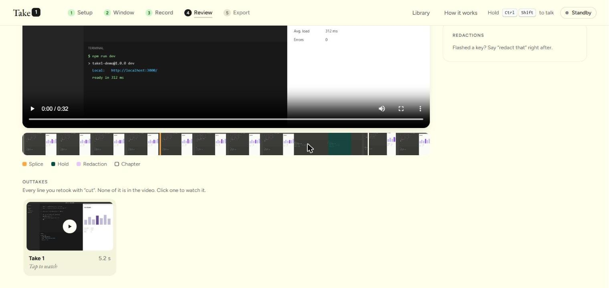

### Export: *“that's a wrap”*

| Card | What you get |
| --- | --- |
| **Final cut** | MP4 with speech levelled to about −16 LUFS (YouTube's loudness). Re-encoded only if something has to be burned in; otherwise the tape is copied as-is, so it's instant and lossless. |
| **Captions** | Generate on your device, download `.srt` / `.vtt`, or **burn them into the video** |
| **Submission post** | Markdown write-up with title, transcript summary and chapters |
| **Social post** | Short post for X / LinkedIn |
| **Chapters** | YouTube-ready chapter list |
| **Blooper reel** | Every outtake back to back, labelled by take |

Edit the **title** at the top and it's used for file names and the Library.

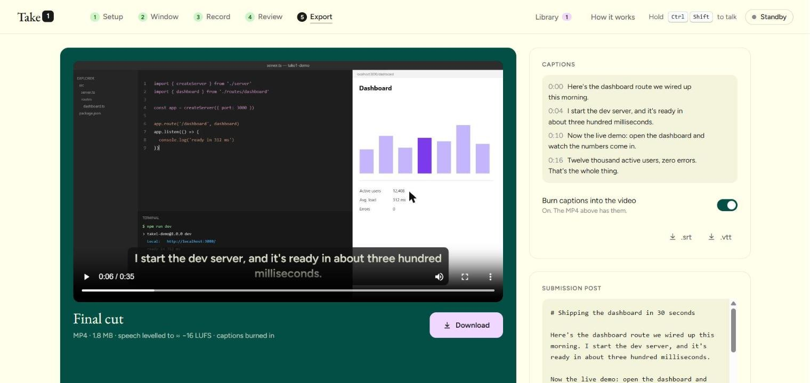

### Library: every take you've exported

Every export is saved automatically in the **Library** (top bar) on this computer, in the browser's IndexedDB. You can play, rename, re-download (MP4, `.srt`, `.vtt`) or delete takes there. Re-exporting the same take, for example after burning in captions, updates its entry instead of adding a duplicate.

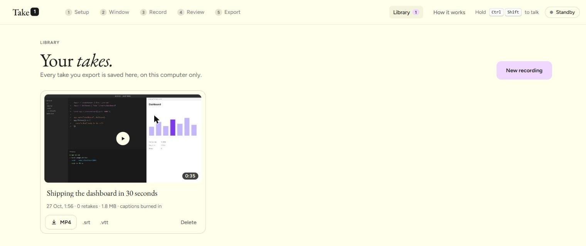

> The browser and the desktop app keep **separate** libraries, because they are different “sites” as far as storage goes.

---

## Captions

Captions are **on demand**. Nothing is transcribed until you ask, so recording stays light.

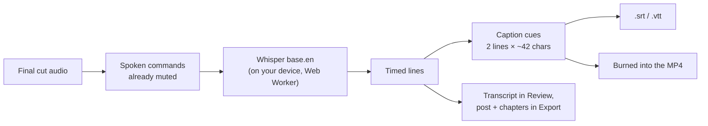

- Click **Transcribe** in Review or **Generate captions** in Export. The first time, the caption model downloads once (about 80 MB) with a progress bar.
- Turn on **Burn captions into the video** and the MP4 is re-rendered with them drawn in.
- If the take has no speech (mic muted, silent room), Take1 tells you so instead of producing empty captions.

---

## Architecture

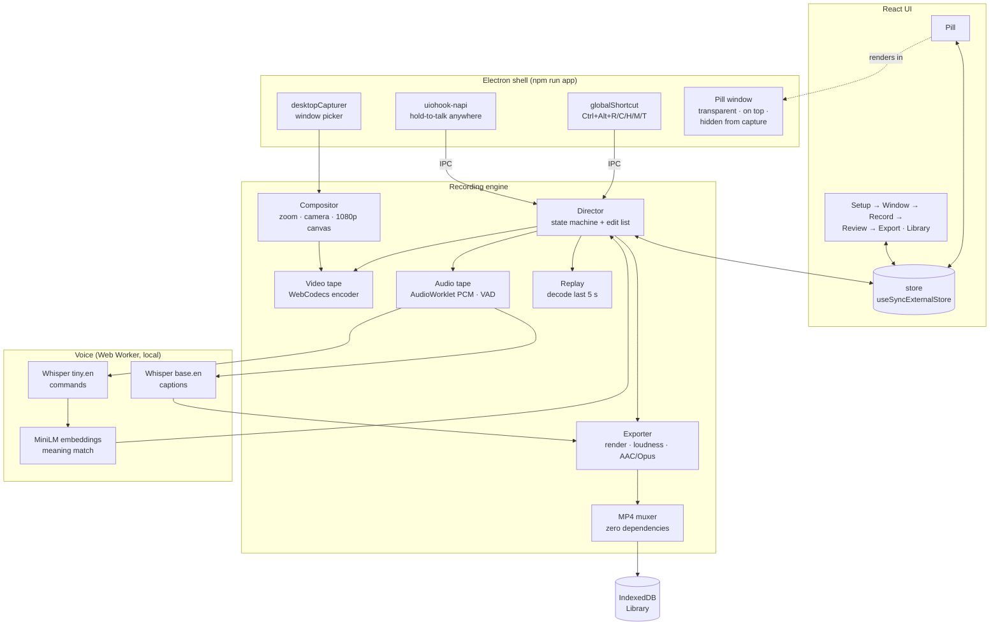

The **Director** is the single place where everything happens. Buttons, hotkeys, the pill and voice all end up calling `director.run(command)`. It owns the two tapes (video chunks and raw PCM audio) plus an edit list of holds, redactions, chapters, zooms and muted command audio. It writes its state into one small store, which every screen reads.

---

## The hard parts

<details>
<summary><b>Cutting compressed video without re-encoding</b></summary>

The video tape is a list of encoded chunks, not frames. You can only start playback from a keyframe, so Take1 forces one at every punch-in, after every hold, and once a second otherwise. A cut drops the chunks after the splice point, and the next chunk recorded is guaranteed to be a keyframe. The result can be stream-copied straight into the MP4.

</details>

<details>
<summary><b>Hold without a speed-ramp editor</b></summary>

During a hold the encoder keeps running, but the tape's clock advances at 1/8 speed, so the wait plays at 8× in the final video. Saying *“hold”* takes a moment, so the silence just before the command is trimmed back off the tape and a keyframe is forced at the join. That way the speed change starts exactly where you stopped talking.

</details>

<details>
<summary><b>An MP4 muxer from scratch</b></summary>

`src/engine/mp4.ts` writes `ftyp/moov/mdat` with `avcC` (H.264) or `vpcC` (VP9) video and `esds` (AAC) or `dOps` (Opus) audio, and moves the index to the front (faststart) so the file plays straight away in a browser. That's around 300 lines with no dependencies.

</details>

<details>
<summary><b>Listening that doesn't die after 40 seconds</b></summary>

The browser's built-in speech recognition times out and drops words, which is why “wrap” used to come back as “rap”. Take1 records the command audio itself, from a tap on the same AudioWorklet that feeds the tape, and runs Whisper locally in a Web Worker. A repair table fixes known mishearings, and an embedding model matches meaning rather than exact words.

</details>

<details>
<summary><b>Recording keeps going when the tab is hidden</b></summary>

Browsers throttle timers in background tabs, which would make the frame rate drop to 1 fps while you present another window. Take1 drives frames from a Web Worker ticker, and the desktop app turns background throttling off.

</details>

<details>
<summary><b>Your commands are muted out of the video</b></summary>

Every command session marks a range on the tape. On export those ranges are faded to silence with 10 ms fades, so the audience never hears “cut” or “that's a wrap”.

</details>

---

## Project structure

```
take1/
├─ electron/
│  ├─ main.cjs          desktop shell: talk-key hook, global shortcuts, pill window, picker
│  └─ preload.cjs       the small, safe bridge the UI talks to (window.take1Native)
├─ src/
│  ├─ App.tsx           top bar, steps, Help + Library, pill portal
│  ├─ screens/
│  │  ├─ GreenRoom.tsx  ① Setup: mic, push-to-talk practice
│  │  ├─ Stage.tsx      ② Window: source, camera, zoom spots
│  │  ├─ Console.tsx    ③ Record: monitor, dock, cheat sheet, settings
│  │  ├─ Dailies.tsx    ④ Review: player, timeline, outtakes, transcript
│  │  ├─ Wrap.tsx       ⑤ Export: MP4, captions, posts, blooper reel
│  │  └─ Library.tsx    every exported take
│  ├─ engine/
│  │  ├─ director.ts    the state machine: roll, cut, hold, punch-in, wrap, export
│  │  ├─ audio.ts       AudioWorklet PCM tape, VAD, sentence finder, splice points
│  │  ├─ videoTape.ts   WebCodecs encoder + chunk tape with forced keyframes
│  │  ├─ compositor.ts  canvas: zoom, camera bubble, redaction blur
│  │  ├─ replay.ts      decode the last N seconds for the punch-in replay
│  │  ├─ exporter.ts    re-render, caption burn-in, loudness, audio encode
│  │  ├─ mp4.ts         zero-dependency MP4 muxer
│  │  ├─ snapshots.ts   thumbnails for the timeline and match meter
│  │  └─ ticker.ts      worker clock that survives hidden tabs
│  ├─ voice/
│  │  ├─ stt.worker.ts  Whisper + MiniLM in a Web Worker
│  │  ├─ stt.ts         worker client, model progress
│  │  ├─ intent.ts      commands, mishearing repairs, meaning match, call sheet
│  │  └─ recognizer.ts  browser speech fallback
│  ├─ features/packet.ts  captions, .srt/.vtt, chapters, posts, title guess
│  ├─ lib/              store, Library (IndexedDB), native bridge, time
│  └─ ui/               Pill, Help, components + per-action animations, styles, sounds
└─ docs/screens/        the images in this README
```

> `src/ui/Hud.tsx` and `src/voice/grammar.ts` may still exist in older checkouts as empty stubs from an earlier build. Nothing imports them, so they're safe to delete.

---

## Troubleshooting

**Ctrl + Shift does nothing.**
In the browser, keys only reach the page when the Take1 tab (or the pill window) is focused. Click the Take1 tab first, or use the **Hold to talk** button, or run `npm run app`. If your keyboard layout switches languages on Ctrl + Shift, choose another talk key in **Record → Settings**. In Setup, the keycaps light up as you press them, which is a quick way to check the keys are arriving.

**“Didn't hear a sentence, so I went back 5 s.”**
The mic was muted or picked up nothing clear, so Take1 stepped back a safe 5 s instead of guessing. Say *cut* again to go back further, or *scratch that* to undo.

**Captions say “No speech found”.**
The final cut has no audible speech. Check the mic picked the right input in Setup.

**The Library is empty but I exported something.**
Takes are saved per browser and per app. A take exported in Chrome won't appear in the desktop app, or the other way round.

**The page shows old screens after updating.**
Stop the dev server and start it again with `npm run dev`.

---

## Known limits

- **Chrome or Edge only.** Take1 needs WebCodecs and `MediaStreamTrackProcessor`. Firefox and Safari aren't supported yet.
- **One take, one session.** After you close the app the Library keeps the exported MP4, but the editable tape (outtakes, re-exporting with different captions) is gone.
- **The Fn key can't be used** on Windows (see [Why not Fn?](#why-not-fn)).
- **English voice models.** Commands and captions use the `.en` Whisper models.

---

## Built by voice

Take1 was made for the **Wispr Flow #NoHandsChallenge**: the ideas, the specs, the bug reports and the design feedback were all spoken through Wispr Flow. It's fitting for a tool whose whole point is that you shouldn't have to reach for the mouse to fix a mistake.

*Roll sound. Roll camera. Action.* 🎬
