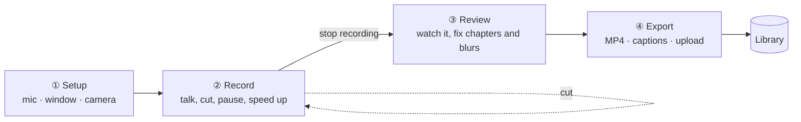
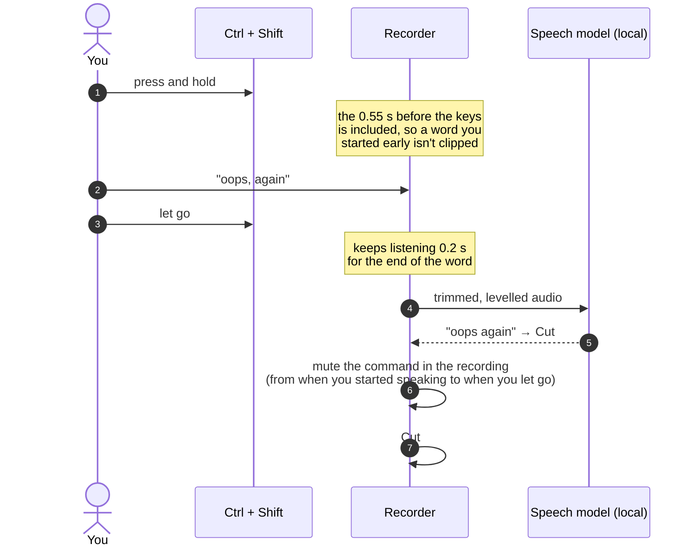
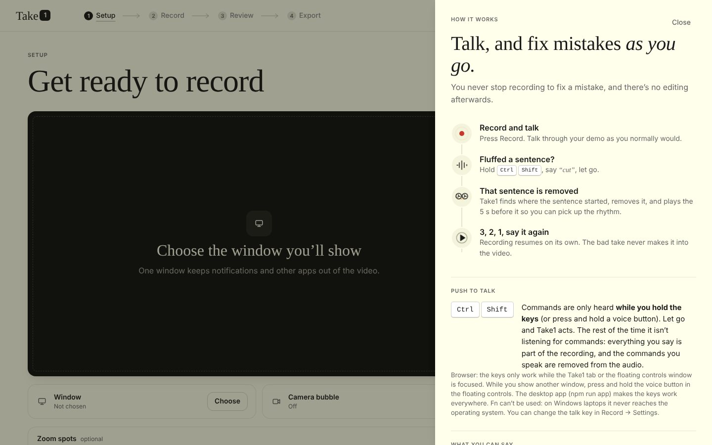
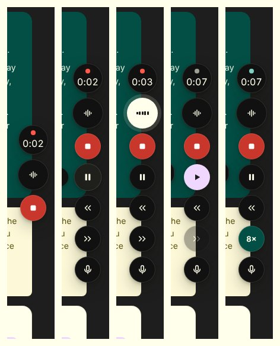
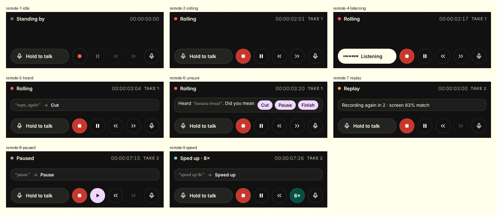
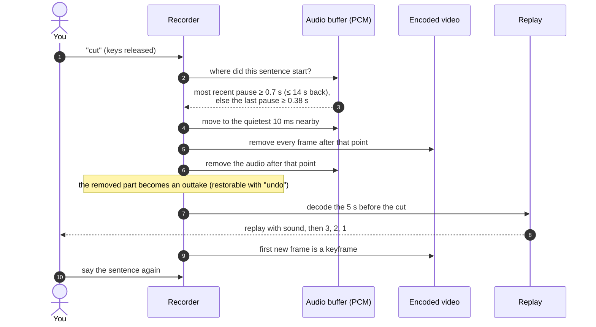
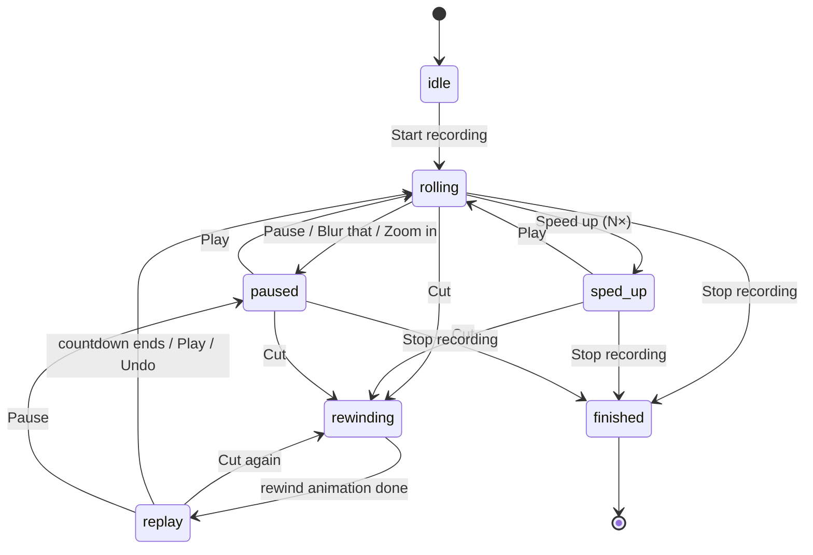
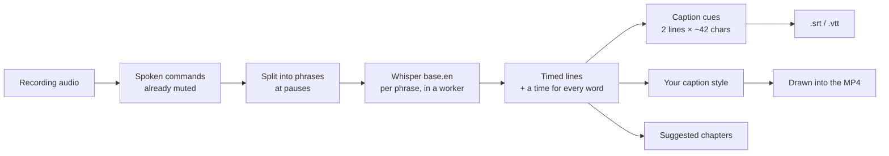
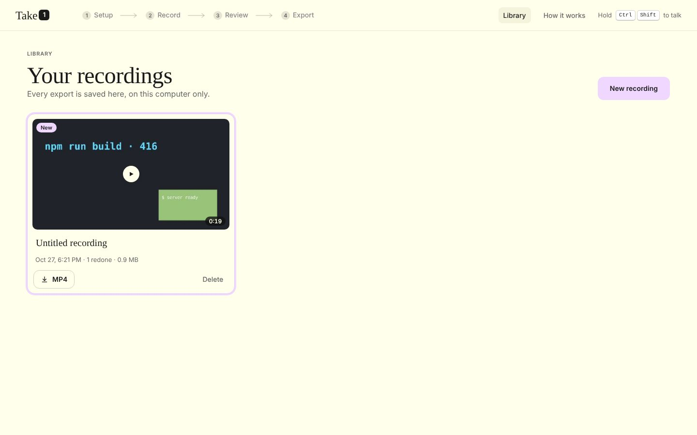
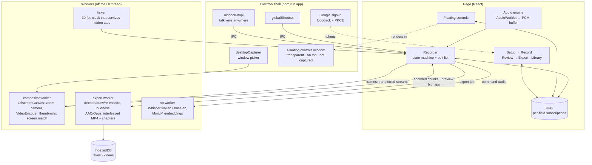

# Take1

**A screen recorder you control with your voice.**

Record a demo the way you'd give it live. If you fluff a sentence, hold <kbd>Ctrl</kbd> + <kbd>Shift</kbd>, say *"cut"* and let go: that sentence is removed, the last five seconds play back so you catch your rhythm, and after 3, 2, 1 you say it again. Need a moment? *"Pause"*, then *"play"*. Waiting for a build? *"Speed up"* and the wait plays at 4×. Flashed a password? *"Blur that"* and drag over it.

When you stop, the video is already edited. Export the MP4 with captions and chapters, then save it to a folder or upload it to YouTube or Google Drive.


---

## Contents

- [Quick start](#quick-start)
- [Four steps](#four-steps)
- [Push to talk](#push-to-talk)
- [What you can say](#what-you-can-say)
- [Shortcuts](#shortcuts)
- [The floating controls](#the-floating-controls)
- [How Cut works](#how-cut-works)
- [Review](#review)
- [Export, captions and chapters](#export-captions-and-chapters)
- [Uploading to YouTube and Google Drive](#uploading-to-youtube-and-google-drive)
- [Library](#library)
- [Architecture](#architecture)
- [Engineering notes](#engineering-notes)
- [Project structure](#project-structure)
- [Troubleshooting](#troubleshooting)
- [Known limits](#known-limits)

---

## Quick start

You need **Node 18+** and **Chrome or Edge** (Take1 uses WebCodecs).

```bash
npm install

npm run app        # desktop app (recommended): talk keys work from any app
npm run app:dev    # desktop app with hot reload
npm run dev        # browser only, opens http://localhost:5173
```

The first time you turn on the microphone, the command model downloads once (about 60 MB) and is cached. A larger, more accurate model (about 80 MB) follows in the background; it makes captions and double-checks unclear commands. After that, recognition runs **on your computer**. Nothing you say is uploaded.

---

## Four steps

The top bar shows where you are. The arrow after the current step lights up as soon as you can move on.



### ① Setup

Turn on the microphone, choose the window you'll show, and optionally your webcam. The first time, Setup also explains push-to-talk and lets you practise; after that it's one compact screen.


*Zoom spots* are optional. You can name parts of the window in advance ("terminal", "preview"), or just say *"zoom in"* while recording and draw the area then.

### ② Record

Press **Record** (or hold the talk keys and say *"start recording"*) and talk through your demo.

| You say | What happens |
| --- | --- |
| **Cut** | The sentence you just said is removed. The 5 s before it play back, with sound, then recording continues after 3, 2, 1. |
| **Pause** / **Play** | Recording stops completely until you say *play*. The word "pause" itself is trimmed off. |
| **Speed up** / **Hold 3×** | The wait plays at 4× (or 2×, 3×, 8×…) in the final video until you say *play*. |
| **Blur that** | Recording pauses and shows the frame. Drag over what should be hidden. It's blurred for the 5 s before you asked, and optionally until you say *unblur*. |
| **Zoom in** | Recording pauses so you can drag the area to zoom into (or *"zoom terminal"* jumps straight to a named spot). |
| **Chapter: setup** | Adds a chapter called "Setup" at that point. |
| **Stop recording** | Done. Opens Review. |


While the replay plays, the **screen match** meter compares your screen now with how it looked where you'll resume, so you don't continue with the wrong tab open. It ignores your webcam bubble.

| Paused | Sped up | Drawing a blur |
| --- | --- | --- |
|  |  |  |

### ③ Review and ④ Export

See [Review](#review) and [Export, captions and chapters](#export-captions-and-chapters).

---

## Push to talk

Take1 hears commands **only while you hold the talk keys** (default <kbd>Ctrl</kbd> + <kbd>Shift</kbd>) or press and hold a voice button. Let go and Take1 acts. The rest of the time, everything you say is part of the recording and is never interpreted.



- **Your commands aren't in the video.** The audio from when you started the command until you let go is faded out. Narration you continue with afterwards is kept.
- **Unclear?** If the fast model isn't sure, a second, more accurate model listens to the same audio before Take1 asks *"Did you mean…"*.
- **Real shortcuts still work.** If a third key joins (say <kbd>Ctrl</kbd>+<kbd>Shift</kbd>+<kbd>T</kbd>), nothing happens.
- <kbd>Esc</kbd> cancels while listening.

### Browser vs desktop app

| | `npm run dev` (browser) | `npm run app` (desktop) |
| --- | --- | --- |
| Talk keys | Only while the Take1 tab or the floating controls window is **focused** | **Anywhere**, even while you type in your editor |
| While you show another app | Press and hold the voice button in the floating controls | Just hold the keys |
| Floating controls in the video? | Yes if you share the whole screen, so pick a window | **Never**: they're excluded from capture |

Browsers only send key presses to the focused page, which is the usual reason for "Ctrl + Shift doesn't work". For real recordings, use the desktop app.

**Why not Fn?** On Windows laptops the Fn key is handled inside the keyboard and never reaches the operating system, so no app can see it. In **Record → Settings** you can choose <kbd>Ctrl</kbd>+<kbd>Win</kbd> (Wispr Flow's Windows default), <kbd>Alt</kbd>+<kbd>Shift</kbd> or <kbd>Right Ctrl</kbd> instead.

---

## What you can say

You don't need exact words. Matching works on meaning and sound, so everyday phrasing and common mishearings ("rap" for wrap, "paws" for pause) still work.

| Say | Or | Does |
| --- | --- | --- |
| **Start recording** | "action", "we're live" | Start recording |
| **Pause** | "hang on", "one sec", "wait" | Stop recording until you say Play |
| **Play** | "continue", "carry on", "normal speed" | Carry on after Pause or Speed up, or skip the countdown |
| **Cut** | "oops, again", "redo that line" | Remove the sentence you just said, replay 5 s, record again |
| **Back ten seconds** | "rewind five" | Remove an exact number of seconds |
| **Speed up** | "hold 3x", "fast forward 8x" | Waiting plays at 4× (or what you say) until Play |
| **Zoom in** | "zoom terminal", "zoom here" | Zoom into a named spot, or pause and draw one |
| **Zoom out** | "full screen" | Back to the whole window |
| **Blur that** | "hide that", "that's private" | Pause and drag over what to blur |
| **Unblur** | "stop blurring" | End a blur you left running |
| **Chapter: live demo** | "new chapter setup", "next part" | Add a named chapter |
| **Undo** | "never mind", "cancel" | Undo the last thing, or cancel a Cut during its replay |
| **Stop recording** | "that's a wrap", "we're done" | Finish and open Review |

The major actions (start, pause, play, cut, speed up, undo, chapter, stop) each have a short sound and an on-screen animation. Zoom and blur stay quiet, since they happen mid-sentence.

---

## Shortcuts

Every action also has a button and a keyboard shortcut. In the desktop app the shortcuts work from any app, and you can change them in **Record → Settings**.

| Shortcut | Does |
| --- | --- |
| Hold <kbd>Ctrl</kbd>+<kbd>Shift</kbd> | Speak a command, release to send |
| <kbd>Ctrl</kbd>+<kbd>Alt</kbd>+<kbd>R</kbd> | Start / stop recording |
| <kbd>Ctrl</kbd>+<kbd>Alt</kbd>+<kbd>P</kbd> | Pause / play |
| <kbd>Ctrl</kbd>+<kbd>Alt</kbd>+<kbd>C</kbd> | Cut (no voice needed) |
| <kbd>Ctrl</kbd>+<kbd>Alt</kbd>+<kbd>H</kbd> | Speed up / normal speed |
| <kbd>Ctrl</kbd>+<kbd>Alt</kbd>+<kbd>M</kbd> | Mute / unmute the mic |
| <kbd>Ctrl</kbd>+<kbd>Alt</kbd>+<kbd>T</kbd> | Show / hide the floating controls |
| <kbd>Esc</kbd> | Cancel a command while listening |

**How it works** in the top bar opens the full guide at any time.



---

## The floating controls

While you show another window, you direct the recording from small controls that float above everything.

**Desktop app:** a column of round buttons on the right edge of the screen, like Wispr Flow's. It stays compact until you hover, never takes focus away from the app you're showing, and is hidden from the recording even when you capture the whole screen. Messages (what it heard, the replay, questions) appear to its left.



**Browser:** Chrome's Picture-in-Picture window can't be transparent or very narrow, so the same controls fill it as a compact dark remote with a status line and a message line.



---

## How Cut works

Everything happens in about a second, while you're still talking.



- **Finding the sentence.** Breaths inside a sentence are usually 0.2–0.4 s; gaps between sentences are longer. Take1 prefers the most recent long pause and falls back to a short one. If it can't find a sentence at all (muted mic, noisy room), it **goes back 5 s** rather than guessing big, and says so.
- **Inaudible joins.** The cut point moves to the quietest 10 ms within 150 ms.
- **No re-encoding.** The first frame after a cut, pause or speed change is a keyframe, so the recording can be joined and copied straight into the MP4.
- **Nothing is lost.** Say *undo* during the replay and the removed sentence comes back.

### Recorder states



---

## Review

The finished video, with every redone sentence already removed. The strip under the player marks the joins (orange), sped-up parts (green) and blurs (lavender). Blurs are previewed as plain blur, exactly as they'll look; you can move or resize the box with **Adjust**.


- **Sentences you redid** are listed below the player and can be played back. None of them are in the video.
- **Transcribe** runs Whisper on your computer and gives you a clickable transcript, captions and suggested chapters.
- **Chapters:** add one at the playhead, rename, remove, or *Suggest from transcript*. A note tells you if YouTube wouldn't accept them (it needs at least three, each at least 10 s long).

---

## Export, captions and chapters


| | |
| --- | --- |
| **MP4** | Speech levelled to about −16 LUFS. Chapters are embedded (VLC, mpv and ffmpeg show them). It's only re-encoded if something has to be drawn in (blurs, captions); otherwise the recording is copied as-is, so export is fast and lossless. |
| **Captions** | Generated on your computer. Download `.srt` / `.vtt`, or style them and draw them into the video (below). |
| **Chapters** | A YouTube-ready list (`0:00 Intro`, …) with a Copy button. They also go into the YouTube description automatically when you upload from Take1. |
| **Send it somewhere** | Save to a folder you pick once (optionally every export, automatically), upload to YouTube or Google Drive, or use your system's share sheet. |

How captions are made:



Splitting at pauses first means every line has honest start and end times, and a quiet microphone still transcribes. If the recording has no audible audio, Take1 says so instead of producing empty captions. Every word also gets its own time (Whisper's word timestamps, or the loudness of the phrase when those aren't available), which is what lets styled captions follow your voice word by word.

### Caption styles

Below the cards on the Export screen, **Caption style** shows your video with the captions playing over it, drawn exactly as they will be drawn into the MP4.

- **Styles**: Classic, Bold pop, One word, Highlight, Karaoke, Blend (the text inverts the picture behind it), Neon and Marker.
- **Place it** by dragging the caption on the picture (it snaps to the centre), or pick Top, Middle or Bottom.
- **Words at a time**: 1, 2, 3, or a full line.
- **Animation**: pop, rise, fade, bounce, or word by word.
- **Spoken word**: change its colour, put a box or a marker stroke behind it, fill words as they're spoken (karaoke), or make it grow.
- **Font, size, text and highlight colours**, plus UPPERCASE, outline, shadow, glow, background and blend.

*Draw into the video* re-exports the MP4 with that style; *Remove from video* goes back to the clean file. Your last style is remembered. The fonts (Figtree, Poppins, Montserrat, Anton, Bebas Neue, Permanent Marker; SIL Open Font License) ship with the app, so drawing captions in never touches the network.

---

## Uploading to YouTube and Google Drive

There are three ways, from least to most setup:

- **By hand (no setup).** Press *Upload* without Google connected and choose *Save the file and open YouTube* (or Drive). Take1 saves the MP4, puts the title and description (with chapters) on your clipboard, and opens the upload page; drag the file in.
- **Connect your own Google account (once, ~5 minutes).** Uploads go straight from Take1 with chapters and captions. Nothing goes through a Take1 server (there isn't one).
  1. Enable the [YouTube Data API v3](https://console.cloud.google.com/apis/library/youtube.googleapis.com) and the [Google Drive API](https://console.cloud.google.com/apis/library/drive.googleapis.com) in a Google Cloud project.
  2. Set up the [consent screen](https://console.cloud.google.com/auth/overview) (External) and add your Google account as a **test user** under *Audience*.
  3. [Create an OAuth client](https://console.cloud.google.com/auth/clients/create):
     - Browser (`npm run dev`): type **Web application**, with `http://localhost:5173` under *Authorised JavaScript origins*.
     - Desktop app (`npm run app`): type **Desktop app**. Copy its client secret too.
  4. In Take1: **Export → Send it somewhere → Connect Google**, and paste the client ID (and the secret for the desktop app).
- **Build a client into your copy.** Put the client ID(s) in a `.env` file (see [`.env.example`](.env.example)). Everyone using that copy just signs in with Google.

YouTube keeps videos uploaded through a personal, unaudited Google project **private**, whatever visibility you pick, until the project passes [YouTube's API audit](https://support.google.com/youtube/contact/yt_api_form). You can change the visibility in YouTube Studio afterwards.

The first upload asks you to sign in; after that your account is remembered. In the browser, sign-in uses Google Identity Services. In the desktop app it opens your normal browser, and the refresh token is stored encrypted by the operating system (`safeStorage`). YouTube uploads can be private, unlisted or public, include the chapters in the description, and attach the captions as a subtitle track. Drive uploads put the MP4 (and the `.srt`) in your Drive and give you a link.

---

## Library

Every export is saved on this computer. The **Library** badge appears only when there's a recording you haven't looked at yet. You can play, rename, re-download (MP4, `.srt`, `.vtt`) and delete recordings.



Recordings live in the browser's IndexedDB in two stores: `takes` holds the small records (title, duration, transcript, chapters, thumbnail) that the Library lists, and `videos` holds the MP4 files, read only when you play or download one. Listing the Library never loads a video into memory. Libraries from older versions are migrated automatically. The browser and the desktop app keep separate libraries.

---

## Architecture



The **Recorder** (`src/engine/recorder.ts`) is the one place where actions happen: buttons, shortcuts, the floating controls and voice all call `recorder.run(command)`. It owns the encoded video chunks, the raw PCM audio and an edit list (sped-up ranges, blurs, chapters, zooms, muted commands), and publishes state to a small store. Screens subscribe to individual fields, so the UI only re-renders when something it shows changes.

The page never draws or encodes video. Window and camera frames go to `compositor.worker` as transferred `ReadableStream<VideoFrame>`s; the worker composites on an `OffscreenCanvas`, encodes, and sends back chunks plus a downscaled preview bitmap. Exports run in `export.worker`, and speech runs in `stt.worker`.

---

## Engineering notes

<details>
<summary><b>Editing compressed video without re-encoding</b></summary>

The recording is a list of encoded chunks. A keyframe is forced after every cut, pause and speed change, and once a second otherwise. A cut removes the chunks after the cut point, and the next chunk is guaranteed to be a keyframe, so the result can be copied straight into the MP4.

</details>

<details>
<summary><b>Speed up without an editor</b></summary>

While sped up, encoding continues at the normal frame rate but the output clock advances at 1/N speed, so N seconds of waiting become one. The moment of silence before "speed up" is trimmed and a keyframe is forced at the join.

</details>

<details>
<summary><b>An interleaved MP4 writer</b></summary>

`src/engine/mp4.ts` writes `ftyp/moov/mdat` with `avcC` (H.264) or `vpcC` (VP9) video, `esds` (AAC) or `dOps` (Opus) audio, and the index first, so it plays before it has fully downloaded. Audio and video are interleaved in ~0.5 s runs (one chunk each per run, with matching `stsc`/`stco` tables), so streaming players read the file front to back. Chapters go in a Nero `chpl` box. Past 4 GB it switches to 64-bit offsets (`co64`) and a 64-bit media size.

</details>

<details>
<summary><b>Recognising short commands reliably</b></summary>

One-syllable commands are easy to clip. Command audio includes the 0.55 s before the keys went down and 0.2 s after they come up, is trimmed to the speech, raised to a healthy level and padded before Whisper sees it. Parsing works on tokens: numbers ("3x", "twenty five") become values, and each word is matched exactly or by its Metaphone key (`src/voice/phonetic.ts`), so mishearings nobody listed still match. Sentence embeddings (MiniLM) cover paraphrases. If the fast model's answer doesn't match a command, the more accurate model gets a second listen before you're asked.

</details>

<details>
<summary><b>Recording keeps going while the tab is hidden</b></summary>

Browsers throttle timers in background tabs. The frame clock runs in a dedicated worker, which isn't throttled, and the desktop app also turns background throttling off.

</details>

<details>
<summary><b>Exports can't hang</b></summary>

Exports report progress from the worker. If nothing moves for 30 s, the export fails with a message instead of sitting on a frozen progress ring. Starting a new recording always clears the previous one completely.

</details>

---

## Project structure

```
take1/
├─ electron/
│  ├─ main.cjs              desktop shell: talk-key hook, shortcuts, floating window, picker, Google sign-in
│  └─ preload.cjs           the small bridge the page talks to (window.take1Native)
├─ src/
│  ├─ App.tsx               top bar with the four steps, Help, Library, floating controls
│  ├─ screens/
│  │  ├─ Setup.tsx          mic, window, camera, zoom spots, push-to-talk practice (first use)
│  │  ├─ Record.tsx         live picture, dock, draw panel, commands, settings
│  │  ├─ Review.tsx         player, timeline, redone sentences, transcript, chapters, blurs
│  │  ├─ Export.tsx         MP4, captions, chapters, save / YouTube / Drive / share
│  │  └─ Library.tsx        every exported recording
│  ├─ engine/
│  │  ├─ recorder.ts        the state machine: record, cut, pause, speed, blur, zoom, finish, export
│  │  ├─ audio.ts           AudioWorklet capture, PCM buffer, sentence finder, quiet splice points
│  │  ├─ compositor.ts      page-side handle for the compositor worker
│  │  ├─ compositor.worker.ts  compositing, encoding, thumbnails, screen matching
│  │  ├─ video.ts           encoded chunk list, keyframe rules, decoding runs
│  │  ├─ export.ts          page-side handle for the export worker
│  │  ├─ export.worker.ts   render, captions, blur, loudness, audio encode, MP4
│  │  ├─ mp4.ts             interleaved MP4 writer with chapters
│  │  ├─ replay.ts          decode the seconds before a cut
│  │  ├─ snapshots.ts       thumbnails for the timeline and outtakes
│  │  └─ ticker.ts          worker clock
│  ├─ voice/
│  │  ├─ stt.worker.ts      Whisper + MiniLM, phrase splitting for transcripts
│  │  ├─ stt.ts             worker client, command audio preparation
│  │  ├─ intent.ts          commands, token parsing, call sheet
│  │  └─ phonetic.ts        Metaphone keys for sound-alike matching
│  ├─ lib/                  store, Library storage, transcript/captions/chapters, sharing, desktop bridge
│  └─ ui/                   floating controls, Help, components, sounds, styles
└─ docs/images/             the pictures in this README
```

---

## Troubleshooting

**Ctrl + Shift does nothing.** In the browser, keys only reach the page while the Take1 tab (or the floating controls window) is focused. Use the voice button, or run `npm run app`. If Ctrl + Shift switches your keyboard language, pick another talk key in **Record → Settings**. On the first-use Setup screen the keycaps light up as you press them, which shows whether the keys are arriving.

**It took a few tries to hear me.** Speak as you press, not after. Take1 includes the moment before the keys, so starting slightly early is fine. If it's still unsure, it shows the closest options to tap.

**"Didn't hear a sentence, so I went back 5 s."** The mic picked up nothing clear. Say *cut* again to go back further, or *undo*.

**Transcription says there's no audible audio.** The recording itself is silent. Check that Setup shows the right microphone and that the bars move.

**Upload asks how to upload.** Google isn't connected yet: upload by hand, or connect it once ([how](#uploading-to-youtube-and-google-drive)).

**“Speech model couldn’t load”.** The first time, the model downloads from huggingface.co; check the connection and press *Try again* (Setup or Record → Settings). It's cached after that.

**The page shows old screens after updating.** Stop the dev server and run `npm run dev` again.

---

## Known limits

- **Chrome or Edge only.** WebCodecs, `MediaStreamTrackProcessor` and transferable streams aren't all available in Firefox or Safari yet.
- **A recording is editable until you start the next one.** The Library keeps the exported MP4, but redoing chapters or blurs on an old recording isn't possible yet.
- **English.** Commands and captions use the English Whisper models.
- **Fn can't be the talk key** on Windows (see [Push to talk](#push-to-talk)).

---

Take1 was built for the Wispr Flow #NoHandsChallenge. The ideas, specs, bug reports and design feedback were spoken, not typed.
